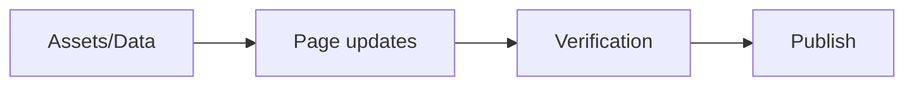
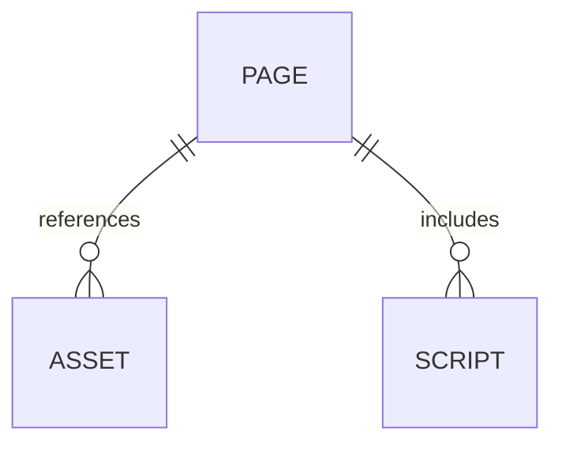
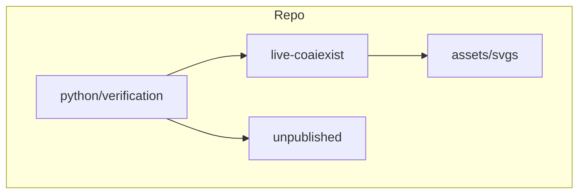
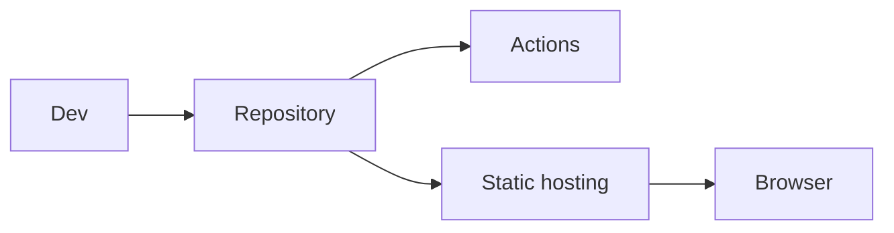
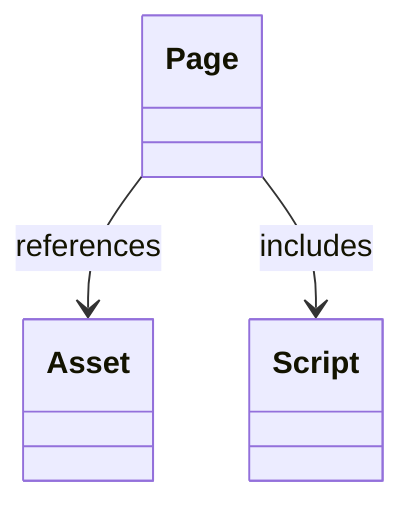
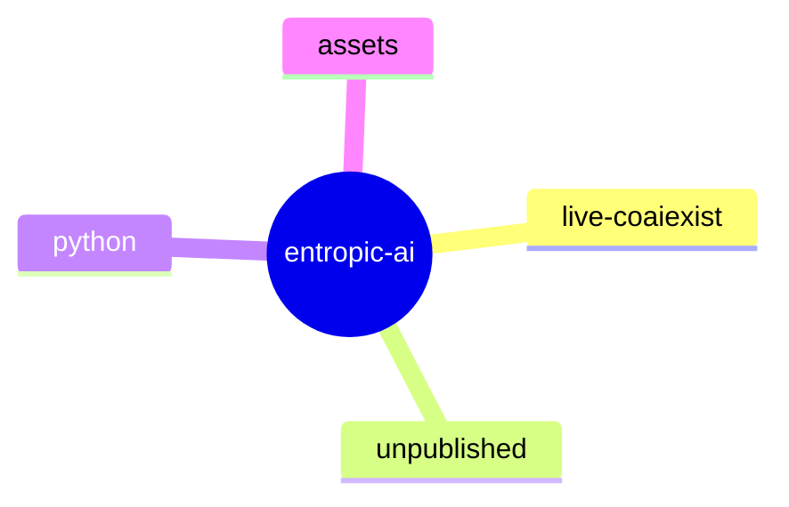

# Executed Diagram Library for `entropic-ai`

This file executes your request by creating a concrete, repo-adapted diagram specification for each listed diagram type.

### 1. Activity diagram used in UML 6/9 and SysML
- Applicability: ✅ High
- Target repo area(s): Platform architecture; Front-end flows; Data modeling; Ops/process
- Execution note: Good fit for software/product repository views.
- Executed spec:


### 2. Bachman diagram
- Applicability: 🟡 Situational
- Target repo area(s): Specialized analysis only
- Execution note: Use for niche investigations or advanced analysis.
- Executed spec:


### 3. Booch – used in software engineering
- Applicability: ✅ High
- Target repo area(s): Platform architecture; Front-end flows; Data modeling; Ops/process
- Execution note: Good fit for software/product repository views.
- Executed spec:


### 4. Bow-tie diagram
- Applicability: ⚪ Low
- Target repo area(s): Not currently recommended
- Execution note: Domain-specific; only adapt metaphorically for repo storytelling.
- Executed spec:
```text
Adapt this domain-specific notation to repo entities: Page, Asset, Script, Check, Publish.
```

### 5. Block diagram
- Applicability: ✅ High
- Target repo area(s): Platform architecture; Front-end flows; Data modeling; Ops/process
- Execution note: Good fit for software/product repository views.
- Executed spec:
```text
Adapt this domain-specific notation to repo entities: Page, Asset, Script, Check, Publish.
```

### 6. Bond graph
- Applicability: 🟡 Situational
- Target repo area(s): Specialized analysis only
- Execution note: Use for niche investigations or advanced analysis.
- Executed spec:
```text
Adapt this domain-specific notation to repo entities: Page, Asset, Script, Check, Publish.
```

### 7. Business Process Diagram
- Applicability: ✅ High
- Target repo area(s): Platform architecture; Front-end flows; Data modeling; Ops/process
- Execution note: Good fit for software/product repository views.
- Executed spec:


### 8. Carroll diagram
- Applicability: 🟡 Situational
- Target repo area(s): Specialized analysis only
- Execution note: Use for niche investigations or advanced analysis.
- Executed spec:
```text
Set A: live-coaiexist pages
Set B: unpublished pages
Set C: shared assets
Intersections identify reusable/shared surface.
```

### 9. Cartogram
- Applicability: 🟡 Situational
- Target repo area(s): Specialized analysis only
- Execution note: Use for niche investigations or advanced analysis.
- Executed spec:
```text
Use file-count and change-frequency metrics across areas:
- live-coaiexist
- unpublished
- python/verification
- assets
Render as the requested chart form.
```

### 10. Catalytic cycle
- Applicability: ⚪ Low
- Target repo area(s): Not currently recommended
- Execution note: Domain-specific; only adapt metaphorically for repo storytelling.
- Executed spec:
```text
Adapt this domain-specific notation to repo entities: Page, Asset, Script, Check, Publish.
```

### 11. Computer network diagram
- Applicability: ✅ High
- Target repo area(s): Platform architecture; Front-end flows; Data modeling; Ops/process
- Execution note: Good fit for software/product repository views.
- Executed spec:


### 12. Chemical equation
- Applicability: ⚪ Low
- Target repo area(s): Not currently recommended
- Execution note: Domain-specific; only adapt metaphorically for repo storytelling.
- Executed spec:
```text
Adapt this domain-specific notation to repo entities: Page, Asset, Script, Check, Publish.
```

### 13. Curly arrow diagram
- Applicability: ⚪ Low
- Target repo area(s): Not currently recommended
- Execution note: Domain-specific; only adapt metaphorically for repo storytelling.
- Executed spec:
```text
Adapt this domain-specific notation to repo entities: Page, Asset, Script, Check, Publish.
```

### 14. Category theory diagrams
- Applicability: 🟡 Situational
- Target repo area(s): Specialized analysis only
- Execution note: Use for niche investigations or advanced analysis.
- Executed spec:
```text
Adapt this domain-specific notation to repo entities: Page, Asset, Script, Check, Publish.
```

### 15. Cause-and-effect diagram
- Applicability: ⚪ Low
- Target repo area(s): Not currently recommended
- Execution note: Domain-specific; only adapt metaphorically for repo storytelling.
- Executed spec:
```text
Adapt this domain-specific notation to repo entities: Page, Asset, Script, Check, Publish.
```

### 16. Chord diagram (disambiguation)
- Applicability: 🟡 Situational
- Target repo area(s): Specialized analysis only
- Execution note: Use for niche investigations or advanced analysis.
- Executed spec:
```text
Use file-count and change-frequency metrics across areas:
- live-coaiexist
- unpublished
- python/verification
- assets
Render as the requested chart form.
```

### 17. Circuit diagram
- Applicability: 🟡 Situational
- Target repo area(s): Specialized analysis only
- Execution note: Use for niche investigations or advanced analysis.
- Executed spec:
```text
Adapt this domain-specific notation to repo entities: Page, Asset, Script, Check, Publish.
```

### 18. Class diagram – from UML 1/9
- Applicability: ✅ High
- Target repo area(s): Platform architecture; Front-end flows; Data modeling; Ops/process
- Execution note: Good fit for software/product repository views.
- Executed spec:


### 19. Cobweb diagram
- Applicability: 🟡 Situational
- Target repo area(s): Specialized analysis only
- Execution note: Use for niche investigations or advanced analysis.
- Executed spec:
```text
Adapt this domain-specific notation to repo entities: Page, Asset, Script, Check, Publish.
```

### 20. Collaboration diagram – from UML 2.0
- Applicability: ✅ High
- Target repo area(s): Platform architecture; Front-end flows; Data modeling; Ops/process
- Execution note: Good fit for software/product repository views.
- Executed spec:
```text
Adapt this domain-specific notation to repo entities: Page, Asset, Script, Check, Publish.
```

### 21. Communication diagram – from UML 2.0
- Applicability: ✅ High
- Target repo area(s): Platform architecture; Front-end flows; Data modeling; Ops/process
- Execution note: Good fit for software/product repository views.
- Executed spec:
```text
Adapt this domain-specific notation to repo entities: Page, Asset, Script, Check, Publish.
```

### 22. Commutative diagram
- Applicability: 🟡 Situational
- Target repo area(s): Specialized analysis only
- Execution note: Use for niche investigations or advanced analysis.
- Executed spec:
```text
Adapt this domain-specific notation to repo entities: Page, Asset, Script, Check, Publish.
```

### 23. Comparison diagram
- Applicability: ✅ High
- Target repo area(s): Platform architecture; Front-end flows; Data modeling; Ops/process
- Execution note: Good fit for software/product repository views.
- Executed spec:
```text
Use file-count and change-frequency metrics across areas:
- live-coaiexist
- unpublished
- python/verification
- assets
Render as the requested chart form.
```

### 24. Component diagram – from UML 3/9
- Applicability: ✅ High
- Target repo area(s): Platform architecture; Front-end flows; Data modeling; Ops/process
- Execution note: Good fit for software/product repository views.
- Executed spec:


### 25. Composite structure diagram – from UML 2.0
- Applicability: ✅ High
- Target repo area(s): Platform architecture; Front-end flows; Data modeling; Ops/process
- Execution note: Good fit for software/product repository views.
- Executed spec:


### 26. Concept map
- Applicability: ✅ High
- Target repo area(s): Platform architecture; Front-end flows; Data modeling; Ops/process
- Execution note: Good fit for software/product repository views.
- Executed spec:
```text
Adapt this domain-specific notation to repo entities: Page, Asset, Script, Check, Publish.
```

### 27. Constellation diagram
- Applicability: 🟡 Situational
- Target repo area(s): Specialized analysis only
- Execution note: Use for niche investigations or advanced analysis.
- Executed spec:
```text
Adapt this domain-specific notation to repo entities: Page, Asset, Script, Check, Publish.
```

### 28. Context diagram
- Applicability: ✅ High
- Target repo area(s): Platform architecture; Front-end flows; Data modeling; Ops/process
- Execution note: Good fit for software/product repository views.
- Executed spec:


### 29. Control flow diagram
- Applicability: ✅ High
- Target repo area(s): Platform architecture; Front-end flows; Data modeling; Ops/process
- Execution note: Good fit for software/product repository views.
- Executed spec:


### 30. Cross functional flowchart
- Applicability: ✅ High
- Target repo area(s): Platform architecture; Front-end flows; Data modeling; Ops/process
- Execution note: Good fit for software/product repository views.
- Executed spec:


### 31. Data model diagram
- Applicability: ✅ High
- Target repo area(s): Platform architecture; Front-end flows; Data modeling; Ops/process
- Execution note: Good fit for software/product repository views.
- Executed spec:
```text
Adapt this domain-specific notation to repo entities: Page, Asset, Script, Check, Publish.
```

### 32. Data flow diagram
- Applicability: ✅ High
- Target repo area(s): Platform architecture; Front-end flows; Data modeling; Ops/process
- Execution note: Good fit for software/product repository views.
- Executed spec:


### 33. Data structure diagram
- Applicability: ✅ High
- Target repo area(s): Platform architecture; Front-end flows; Data modeling; Ops/process
- Execution note: Good fit for software/product repository views.
- Executed spec:
```text
Adapt this domain-specific notation to repo entities: Page, Asset, Script, Check, Publish.
```

### 34. Dendrogram
- Applicability: 🟡 Situational
- Target repo area(s): Specialized analysis only
- Execution note: Use for niche investigations or advanced analysis.
- Executed spec:


### 35. Dependency diagram
- Applicability: ✅ High
- Target repo area(s): Platform architecture; Front-end flows; Data modeling; Ops/process
- Execution note: Good fit for software/product repository views.
- Executed spec:


### 36. Deployment diagram – from UML 9/9
- Applicability: ✅ High
- Target repo area(s): Platform architecture; Front-end flows; Data modeling; Ops/process
- Execution note: Good fit for software/product repository views.
- Executed spec:


### 37. Dynkin diagram
- Applicability: ⚪ Low
- Target repo area(s): Not currently recommended
- Execution note: Domain-specific; only adapt metaphorically for repo storytelling.
- Executed spec:
```text
Adapt this domain-specific notation to repo entities: Page, Asset, Script, Check, Publish.
```

### 38. Dot and cross diagram
- Applicability: ⚪ Low
- Target repo area(s): Not currently recommended
- Execution note: Domain-specific; only adapt metaphorically for repo storytelling.
- Executed spec:
```text
Adapt this domain-specific notation to repo entities: Page, Asset, Script, Check, Publish.
```

### 39. Double bubble map – used in education
- Applicability: 🟡 Situational
- Target repo area(s): Specialized analysis only
- Execution note: Use for niche investigations or advanced analysis.
- Executed spec:
```text
Set A: live-coaiexist pages
Set B: unpublished pages
Set C: shared assets
Intersections identify reusable/shared surface.
```

### 40. Drakon-chart
- Applicability: ✅ High
- Target repo area(s): Platform architecture; Front-end flows; Data modeling; Ops/process
- Execution note: Good fit for software/product repository views.
- Executed spec:


### 41. Entity-relationship diagram (ERD)
- Applicability: ✅ High
- Target repo area(s): Platform architecture; Front-end flows; Data modeling; Ops/process
- Execution note: Good fit for software/product repository views.
- Executed spec:


### 42. Event-driven process chain
- Applicability: ✅ High
- Target repo area(s): Platform architecture; Front-end flows; Data modeling; Ops/process
- Execution note: Good fit for software/product repository views.
- Executed spec:
```text
Adapt this domain-specific notation to repo entities: Page, Asset, Script, Check, Publish.
```

### 43. Euler diagram
- Applicability: 🟡 Situational
- Target repo area(s): Specialized analysis only
- Execution note: Use for niche investigations or advanced analysis.
- Executed spec:
```text
Set A: live-coaiexist pages
Set B: unpublished pages
Set C: shared assets
Intersections identify reusable/shared surface.
```

### 44. Eye diagram – a diagram of a received telecommunications signal
- Applicability: ⚪ Low
- Target repo area(s): Not currently recommended
- Execution note: Domain-specific; only adapt metaphorically for repo storytelling.
- Executed spec:
```text
Timing checkpoints: edit -> verify -> publish
Capture timestamps and variance for charting.
```

### 45. Exploded-view drawing
- Applicability: 🟡 Situational
- Target repo area(s): Specialized analysis only
- Execution note: Use for niche investigations or advanced analysis.
- Executed spec:
```text
Adapt this domain-specific notation to repo entities: Page, Asset, Script, Check, Publish.
```

### 46. Express-G
- Applicability: 🟡 Situational
- Target repo area(s): Specialized analysis only
- Execution note: Use for niche investigations or advanced analysis.
- Executed spec:
```text
Adapt this domain-specific notation to repo entities: Page, Asset, Script, Check, Publish.
```

### 47. Family tree
- Applicability: 🟡 Situational
- Target repo area(s): Specialized analysis only
- Execution note: Use for niche investigations or advanced analysis.
- Executed spec:
```text
Adapt this domain-specific notation to repo entities: Page, Asset, Script, Check, Publish.
```

### 48. Feynman diagram
- Applicability: ⚪ Low
- Target repo area(s): Not currently recommended
- Execution note: Domain-specific; only adapt metaphorically for repo storytelling.
- Executed spec:
```text
Adapt this domain-specific notation to repo entities: Page, Asset, Script, Check, Publish.
```

### 49. Flow chart
- Applicability: ✅ High
- Target repo area(s): Platform architecture; Front-end flows; Data modeling; Ops/process
- Execution note: Good fit for software/product repository views.
- Executed spec:


### 50. Flow process chart
- Applicability: ✅ High
- Target repo area(s): Platform architecture; Front-end flows; Data modeling; Ops/process
- Execution note: Good fit for software/product repository views.
- Executed spec:


### 51. Flow diagram
- Applicability: ✅ High
- Target repo area(s): Platform architecture; Front-end flows; Data modeling; Ops/process
- Execution note: Good fit for software/product repository views.
- Executed spec:


### 52. Free body diagram
- Applicability: ⚪ Low
- Target repo area(s): Not currently recommended
- Execution note: Domain-specific; only adapt metaphorically for repo storytelling.
- Executed spec:
```text
Adapt this domain-specific notation to repo entities: Page, Asset, Script, Check, Publish.
```

### 53. Gantt chart – shows the timing of tasks or activities (used in project management)
- Applicability: ✅ High
- Target repo area(s): Platform architecture; Front-end flows; Data modeling; Ops/process
- Execution note: Good fit for software/product repository views.
- Executed spec:
```mermaid
gantt
  title Visualization implementation
  dateFormat YYYY-MM-DD
  section Work
  model repo :a1, 2026-02-16,2d
  build diagrams :a2, after a1,3d
  publish docs :a3, after a2,1d
```

### 54. Grotrian diagram
- Applicability: ⚪ Low
- Target repo area(s): Not currently recommended
- Execution note: Domain-specific; only adapt metaphorically for repo storytelling.
- Executed spec:
```text
Adapt this domain-specific notation to repo entities: Page, Asset, Script, Check, Publish.
```

### 55. Goodman diagram – shows the fatigue data (example: for a wind turbine blades)
- Applicability: ✅ High
- Target repo area(s): Platform architecture; Front-end flows; Data modeling; Ops/process
- Execution note: Good fit for software/product repository views.
- Executed spec:
```text
Adapt this domain-specific notation to repo entities: Page, Asset, Script, Check, Publish.
```

### 56. Hasse diagram
- Applicability: 🟡 Situational
- Target repo area(s): Specialized analysis only
- Execution note: Use for niche investigations or advanced analysis.
- Executed spec:
```text
Adapt this domain-specific notation to repo entities: Page, Asset, Script, Check, Publish.
```

### 57. HIPO diagram
- Applicability: ✅ High
- Target repo area(s): Platform architecture; Front-end flows; Data modeling; Ops/process
- Execution note: Good fit for software/product repository views.
- Executed spec:
```mermaid
flowchart TB
  subgraph Repo
    Live[live-coaiexist]
    Drafts[unpublished]
    Tools[python/verification]
    Assets[assets/svgs]
  end
  Tools --> Live
  Tools --> Drafts
  Live --> Assets
```

### 58. Internal block diagram (IBD) used in SysML
- Applicability: ✅ High
- Target repo area(s): Platform architecture; Front-end flows; Data modeling; Ops/process
- Execution note: Good fit for software/product repository views.
- Executed spec:
```mermaid
flowchart TB
  subgraph Repo
    Live[live-coaiexist]
    Drafts[unpublished]
    Tools[python/verification]
    Assets[assets/svgs]
  end
  Tools --> Live
  Tools --> Drafts
  Live --> Assets
```

### 59. IDEF0
- Applicability: ✅ High
- Target repo area(s): Platform architecture; Front-end flows; Data modeling; Ops/process
- Execution note: Good fit for software/product repository views.
- Executed spec:
```text
Adapt this domain-specific notation to repo entities: Page, Asset, Script, Check, Publish.
```

### 60. IDEF1 (entity relations)
- Applicability: ⚪ Low
- Target repo area(s): Not currently recommended
- Execution note: Domain-specific; only adapt metaphorically for repo storytelling.
- Executed spec:
```mermaid
erDiagram
  PAGE ||--o{ ASSET : references
  PAGE ||--o{ SCRIPT : includes
```

### 61. Interaction overview diagram – from UML
- Applicability: ✅ High
- Target repo area(s): Platform architecture; Front-end flows; Data modeling; Ops/process
- Execution note: Good fit for software/product repository views.
- Executed spec:
```text
Adapt this domain-specific notation to repo entities: Page, Asset, Script, Check, Publish.
```

### 62. Ishikawa diagram
- Applicability: ✅ High
- Target repo area(s): Platform architecture; Front-end flows; Data modeling; Ops/process
- Execution note: Good fit for software/product repository views.
- Executed spec:
```mermaid
flowchart LR
  A[Assets/Data] --> B[Page updates]
  B --> C[Verification]
  C --> D[Publish]
```

### 63. Jackson diagram
- Applicability: ✅ High
- Target repo area(s): Platform architecture; Front-end flows; Data modeling; Ops/process
- Execution note: Good fit for software/product repository views.
- Executed spec:
```text
Adapt this domain-specific notation to repo entities: Page, Asset, Script, Check, Publish.
```

### 64. Jones diagram
- Applicability: 🟡 Situational
- Target repo area(s): Specialized analysis only
- Execution note: Use for niche investigations or advanced analysis.
- Executed spec:
```text
Adapt this domain-specific notation to repo entities: Page, Asset, Script, Check, Publish.
```

### 65. Karnaugh map
- Applicability: 🟡 Situational
- Target repo area(s): Specialized analysis only
- Execution note: Use for niche investigations or advanced analysis.
- Executed spec:
```text
Adapt this domain-specific notation to repo entities: Page, Asset, Script, Check, Publish.
```

### 66. Kinematic diagram
- Applicability: 🟡 Situational
- Target repo area(s): Specialized analysis only
- Execution note: Use for niche investigations or advanced analysis.
- Executed spec:
```text
Adapt this domain-specific notation to repo entities: Page, Asset, Script, Check, Publish.
```

### 67. Knot diagram
- Applicability: 🟡 Situational
- Target repo area(s): Specialized analysis only
- Execution note: Use for niche investigations or advanced analysis.
- Executed spec:
```text
Adapt this domain-specific notation to repo entities: Page, Asset, Script, Check, Publish.
```

### 68. Ladder diagram
- Applicability: 🟡 Situational
- Target repo area(s): Specialized analysis only
- Execution note: Use for niche investigations or advanced analysis.
- Executed spec:
```text
Adapt this domain-specific notation to repo entities: Page, Asset, Script, Check, Publish.
```

### 69. Levi graph
- Applicability: 🟡 Situational
- Target repo area(s): Specialized analysis only
- Execution note: Use for niche investigations or advanced analysis.
- Executed spec:
```text
Adapt this domain-specific notation to repo entities: Page, Asset, Script, Check, Publish.
```

### 70. Line of balance
- Applicability: 🟡 Situational
- Target repo area(s): Specialized analysis only
- Execution note: Use for niche investigations or advanced analysis.
- Executed spec:
```mermaid
gantt
  title Visualization implementation
  dateFormat YYYY-MM-DD
  section Work
  model repo :a1, 2026-02-16,2d
  build diagrams :a2, after a1,3d
  publish docs :a3, after a2,1d
```

### 71. Link grammar diagram
- Applicability: 🟡 Situational
- Target repo area(s): Specialized analysis only
- Execution note: Use for niche investigations or advanced analysis.
- Executed spec:
```text
Pipeline grammar:
Page := Header Body Assets Scripts
Body := Section+
Section := Text | Media | Embed
```

### 72. Message sequence chart
- Applicability: ✅ High
- Target repo area(s): Platform architecture; Front-end flows; Data modeling; Ops/process
- Execution note: Good fit for software/product repository views.
- Executed spec:
```mermaid
sequenceDiagram
  participant Author
  participant Repo
  participant Verify
  Author->>Repo: commit content update
  Author->>Verify: run checks
  Verify-->>Author: status
```

### 73. Mind map – used for learning, brainstorming, memory, visual thinking and problem solving
- Applicability: ✅ High
- Target repo area(s): Platform architecture; Front-end flows; Data modeling; Ops/process
- Execution note: Good fit for software/product repository views.
- Executed spec:
```mermaid
mindmap
  root((entropic-ai))
    live-coaiexist
    unpublished
    python
    assets
```

### 74. Minkowski spacetime diagram
- Applicability: ⚪ Low
- Target repo area(s): Not currently recommended
- Execution note: Domain-specific; only adapt metaphorically for repo storytelling.
- Executed spec:
```text
Adapt this domain-specific notation to repo entities: Page, Asset, Script, Check, Publish.
```

### 75. Molecular orbital diagram
- Applicability: ⚪ Low
- Target repo area(s): Not currently recommended
- Execution note: Domain-specific; only adapt metaphorically for repo storytelling.
- Executed spec:
```text
Adapt this domain-specific notation to repo entities: Page, Asset, Script, Check, Publish.
```

### 76. Motion diagram
- Applicability: 🟡 Situational
- Target repo area(s): Specialized analysis only
- Execution note: Use for niche investigations or advanced analysis.
- Executed spec:
```text
Adapt this domain-specific notation to repo entities: Page, Asset, Script, Check, Publish.
```

### 77. N2
- Applicability: 🟡 Situational
- Target repo area(s): Specialized analysis only
- Execution note: Use for niche investigations or advanced analysis.
- Executed spec:
```text
Adapt this domain-specific notation to repo entities: Page, Asset, Script, Check, Publish.
```

### 78. Nassi–Shneiderman diagram or structogram – a representation for structured programming
- Applicability: 🟡 Situational
- Target repo area(s): Specialized analysis only
- Execution note: Use for niche investigations or advanced analysis.
- Executed spec:
```text
Pipeline grammar:
Page := Header Body Assets Scripts
Body := Section+
Section := Text | Media | Embed
```

### 79. Nomogram
- Applicability: 🟡 Situational
- Target repo area(s): Specialized analysis only
- Execution note: Use for niche investigations or advanced analysis.
- Executed spec:
```text
Adapt this domain-specific notation to repo entities: Page, Asset, Script, Check, Publish.
```

### 80. Network diagram
- Applicability: ✅ High
- Target repo area(s): Platform architecture; Front-end flows; Data modeling; Ops/process
- Execution note: Good fit for software/product repository views.
- Executed spec:
```mermaid
flowchart LR
  Dev --> Git[Repository]
  Git --> CI[Actions]
  Git --> Host[Static hosting]
  Host --> User[Browser]
```

### 81. O–C diagram – a diagnostic plot of observed minus predicted values over time
- Applicability: 🟡 Situational
- Target repo area(s): Specialized analysis only
- Execution note: Use for niche investigations or advanced analysis.
- Executed spec:
```text
Timing checkpoints: edit -> verify -> publish
Capture timestamps and variance for charting.
```

### 82. Object diagram – from UML 2/9
- Applicability: ✅ High
- Target repo area(s): Platform architecture; Front-end flows; Data modeling; Ops/process
- Execution note: Good fit for software/product repository views.
- Executed spec:
```mermaid
flowchart TB
  subgraph Repo
    Live[live-coaiexist]
    Drafts[unpublished]
    Tools[python/verification]
    Assets[assets/svgs]
  end
  Tools --> Live
  Tools --> Drafts
  Live --> Assets
```

### 83. Organigram
- Applicability: ✅ High
- Target repo area(s): Platform architecture; Front-end flows; Data modeling; Ops/process
- Execution note: Good fit for software/product repository views.
- Executed spec:
```text
Adapt this domain-specific notation to repo entities: Page, Asset, Script, Check, Publish.
```

### 84. Onion diagram – also known as "stacked Venn diagram"
- Applicability: ✅ High
- Target repo area(s): Platform architecture; Front-end flows; Data modeling; Ops/process
- Execution note: Good fit for software/product repository views.
- Executed spec:
```text
Set A: live-coaiexist pages
Set B: unpublished pages
Set C: shared assets
Intersections identify reusable/shared surface.
```

### 85. Package diagram from UML 4/9 and SysML
- Applicability: ✅ High
- Target repo area(s): Platform architecture; Front-end flows; Data modeling; Ops/process
- Execution note: Good fit for software/product repository views.
- Executed spec:
```mermaid
flowchart TB
  subgraph Repo
    Live[live-coaiexist]
    Drafts[unpublished]
    Tools[python/verification]
    Assets[assets/svgs]
  end
  Tools --> Live
  Tools --> Drafts
  Live --> Assets
```

### 86. Parametric diagram from SysML
- Applicability: ✅ High
- Target repo area(s): Platform architecture; Front-end flows; Data modeling; Ops/process
- Execution note: Good fit for software/product repository views.
- Executed spec:
```text
Adapt this domain-specific notation to repo entities: Page, Asset, Script, Check, Publish.
```

### 87. PERT
- Applicability: ✅ High
- Target repo area(s): Platform architecture; Front-end flows; Data modeling; Ops/process
- Execution note: Good fit for software/product repository views.
- Executed spec:
```mermaid
gantt
  title Visualization implementation
  dateFormat YYYY-MM-DD
  section Work
  model repo :a1, 2026-02-16,2d
  build diagrams :a2, after a1,3d
  publish docs :a3, after a2,1d
```

### 88. Petri net – shows the structure of a distributed system as a directed bipartite graph with annotations
- Applicability: ✅ High
- Target repo area(s): Platform architecture; Front-end flows; Data modeling; Ops/process
- Execution note: Good fit for software/product repository views.
- Executed spec:
```text
Places: Draft, Checked, Published
Transitions: Submit, PassChecks, Rollback
```

### 89. Phylogenetic tree - represents a phylogeny (evolutionary relationships among groups of organisms)
- Applicability: 🟡 Situational
- Target repo area(s): Specialized analysis only
- Execution note: Use for niche investigations or advanced analysis.
- Executed spec:
```text
Adapt this domain-specific notation to repo entities: Page, Asset, Script, Check, Publish.
```

### 90. Piping and instrumentation diagram (P&ID)
- Applicability: 🟡 Situational
- Target repo area(s): Specialized analysis only
- Execution note: Use for niche investigations or advanced analysis.
- Executed spec:
```text
Adapt this domain-specific notation to repo entities: Page, Asset, Script, Check, Publish.
```

### 91. Phase diagram used to present solid/liquid/gas information
- Applicability: 🟡 Situational
- Target repo area(s): Specialized analysis only
- Execution note: Use for niche investigations or advanced analysis.
- Executed spec:
```text
Adapt this domain-specific notation to repo entities: Page, Asset, Script, Check, Publish.
```

### 92. Plant diagram
- Applicability: 🟡 Situational
- Target repo area(s): Specialized analysis only
- Execution note: Use for niche investigations or advanced analysis.
- Executed spec:
```text
Adapt this domain-specific notation to repo entities: Page, Asset, Script, Check, Publish.
```

### 93. Pressure volume diagram used to analyse engines
- Applicability: ⚪ Low
- Target repo area(s): Not currently recommended
- Execution note: Domain-specific; only adapt metaphorically for repo storytelling.
- Executed spec:
```text
Adapt this domain-specific notation to repo entities: Page, Asset, Script, Check, Publish.
```

### 94. Pourbaix diagram
- Applicability: ⚪ Low
- Target repo area(s): Not currently recommended
- Execution note: Domain-specific; only adapt metaphorically for repo storytelling.
- Executed spec:
```text
Adapt this domain-specific notation to repo entities: Page, Asset, Script, Check, Publish.
```

### 95. Process flow diagram or PFD – used in chemical engineering
- Applicability: ✅ High
- Target repo area(s): Platform architecture; Front-end flows; Data modeling; Ops/process
- Execution note: Good fit for software/product repository views.
- Executed spec:
```mermaid
flowchart LR
  A[Assets/Data] --> B[Page updates]
  B --> C[Verification]
  C --> D[Publish]
```

### 96. Program structure diagram
- Applicability: ✅ High
- Target repo area(s): Platform architecture; Front-end flows; Data modeling; Ops/process
- Execution note: Good fit for software/product repository views.
- Executed spec:
```text
Adapt this domain-specific notation to repo entities: Page, Asset, Script, Check, Publish.
```

### 97. Radar chart
- Applicability: ✅ High
- Target repo area(s): Platform architecture; Front-end flows; Data modeling; Ops/process
- Execution note: Good fit for software/product repository views.
- Executed spec:
```text
Use file-count and change-frequency metrics across areas:
- live-coaiexist
- unpublished
- python/verification
- assets
Render as the requested chart form.
```

### 98. Radial diagram
- Applicability: ✅ High
- Target repo area(s): Platform architecture; Front-end flows; Data modeling; Ops/process
- Execution note: Good fit for software/product repository views.
- Executed spec:
```text
Use file-count and change-frequency metrics across areas:
- live-coaiexist
- unpublished
- python/verification
- assets
Render as the requested chart form.
```

### 99. Requirement diagram Used in SysML
- Applicability: ✅ High
- Target repo area(s): Platform architecture; Front-end flows; Data modeling; Ops/process
- Execution note: Good fit for software/product repository views.
- Executed spec:
```text
Adapt this domain-specific notation to repo entities: Page, Asset, Script, Check, Publish.
```

### 100. Rich picture
- Applicability: ✅ High
- Target repo area(s): Platform architecture; Front-end flows; Data modeling; Ops/process
- Execution note: Good fit for software/product repository views.
- Executed spec:
```text
Adapt this domain-specific notation to repo entities: Page, Asset, Script, Check, Publish.
```

### 101. R-diagram
- Applicability: 🟡 Situational
- Target repo area(s): Specialized analysis only
- Execution note: Use for niche investigations or advanced analysis.
- Executed spec:
```text
Adapt this domain-specific notation to repo entities: Page, Asset, Script, Check, Publish.
```

### 102. Routing diagram
- Applicability: ✅ High
- Target repo area(s): Platform architecture; Front-end flows; Data modeling; Ops/process
- Execution note: Good fit for software/product repository views.
- Executed spec:
```mermaid
flowchart LR
  Dev --> Git[Repository]
  Git --> CI[Actions]
  Git --> Host[Static hosting]
  Host --> User[Browser]
```

### 103. Sankey diagram – represents material, energy or cost flows with quantity proportional arrows in a process network
- Applicability: ✅ High
- Target repo area(s): Platform architecture; Front-end flows; Data modeling; Ops/process
- Execution note: Good fit for software/product repository views.
- Executed spec:
```mermaid
flowchart LR
  A[Assets/Data] --> B[Page updates]
  B --> C[Verification]
  C --> D[Publish]
```

### 104. Sentence diagram – represents the grammatical structure of a natural language sentence
- Applicability: 🟡 Situational
- Target repo area(s): Specialized analysis only
- Execution note: Use for niche investigations or advanced analysis.
- Executed spec:
```text
Pipeline grammar:
Page := Header Body Assets Scripts
Body := Section+
Section := Text | Media | Embed
```

### 105. Sequence diagram from UML 8/9 and SysML
- Applicability: ✅ High
- Target repo area(s): Platform architecture; Front-end flows; Data modeling; Ops/process
- Execution note: Good fit for software/product repository views.
- Executed spec:
```mermaid
sequenceDiagram
  participant Author
  participant Repo
  participant Verify
  Author->>Repo: commit content update
  Author->>Verify: run checks
  Verify-->>Author: status
```

### 106. Single-line diagram
- Applicability: 🟡 Situational
- Target repo area(s): Specialized analysis only
- Execution note: Use for niche investigations or advanced analysis.
- Executed spec:
```mermaid
flowchart LR
  Dev --> Git[Repository]
  Git --> CI[Actions]
  Git --> Host[Static hosting]
  Host --> User[Browser]
```

### 107. SDL/GR diagram – specification and description Language. SDL is a formal language used in computer science.
- Applicability: ⚪ Low
- Target repo area(s): Not currently recommended
- Execution note: Domain-specific; only adapt metaphorically for repo storytelling.
- Executed spec:
```text
Pipeline grammar:
Page := Header Body Assets Scripts
Body := Section+
Section := Text | Media | Embed
```

### 108. Smith chart
- Applicability: 🟡 Situational
- Target repo area(s): Specialized analysis only
- Execution note: Use for niche investigations or advanced analysis.
- Executed spec:
```text
Timing checkpoints: edit -> verify -> publish
Capture timestamps and variance for charting.
```

### 109. Spider chart
- Applicability: ✅ High
- Target repo area(s): Platform architecture; Front-end flows; Data modeling; Ops/process
- Execution note: Good fit for software/product repository views.
- Executed spec:
```text
Use file-count and change-frequency metrics across areas:
- live-coaiexist
- unpublished
- python/verification
- assets
Render as the requested chart form.
```

### 110. Spray diagram
- Applicability: 🟡 Situational
- Target repo area(s): Specialized analysis only
- Execution note: Use for niche investigations or advanced analysis.
- Executed spec:
```text
Adapt this domain-specific notation to repo entities: Page, Asset, Script, Check, Publish.
```

### 111. SSADM – structured systems analysis and design methodology (used in software engineering)
- Applicability: ✅ High
- Target repo area(s): Platform architecture; Front-end flows; Data modeling; Ops/process
- Execution note: Good fit for software/product repository views.
- Executed spec:
```mermaid
flowchart TB
  subgraph Repo
    Live[live-coaiexist]
    Drafts[unpublished]
    Tools[python/verification]
    Assets[assets/svgs]
  end
  Tools --> Live
  Tools --> Drafts
  Live --> Assets
```

### 112. Star chart/Celestial sphere
- Applicability: ⚪ Low
- Target repo area(s): Not currently recommended
- Execution note: Domain-specific; only adapt metaphorically for repo storytelling.
- Executed spec:
```text
Adapt this domain-specific notation to repo entities: Page, Asset, Script, Check, Publish.
```

### 113. State diagram are used for state machines in software engineering from UML 7/9
- Applicability: ✅ High
- Target repo area(s): Platform architecture; Front-end flows; Data modeling; Ops/process
- Execution note: Good fit for software/product repository views.
- Executed spec:
```mermaid
stateDiagram-v2
  [*] --> Draft
  Draft --> Checked
  Checked --> Published
  Published --> Draft: rollback/hotfix
```

### 114. Structural formula
- Applicability: ⚪ Low
- Target repo area(s): Not currently recommended
- Execution note: Domain-specific; only adapt metaphorically for repo storytelling.
- Executed spec:
```text
Adapt this domain-specific notation to repo entities: Page, Asset, Script, Check, Publish.
```

### 115. Swim lane
- Applicability: ✅ High
- Target repo area(s): Platform architecture; Front-end flows; Data modeling; Ops/process
- Execution note: Good fit for software/product repository views.
- Executed spec:
```mermaid
flowchart LR
  A[Assets/Data] --> B[Page updates]
  B --> C[Verification]
  C --> D[Publish]
```

### 116. Syntax diagram used in software engineering to represent a context-free grammar
- Applicability: ✅ High
- Target repo area(s): Platform architecture; Front-end flows; Data modeling; Ops/process
- Execution note: Good fit for software/product repository views.
- Executed spec:
```text
Pipeline grammar:
Page := Header Body Assets Scripts
Body := Section+
Section := Text | Media | Embed
```

### 117. Systems Biology Graphical Notation – a graphical notation used in diagrams of biochemical and cellular processes studied in systems biology
- Applicability: ⚪ Low
- Target repo area(s): Not currently recommended
- Execution note: Domain-specific; only adapt metaphorically for repo storytelling.
- Executed spec:
```text
Adapt this domain-specific notation to repo entities: Page, Asset, Script, Check, Publish.
```

### 118. System context diagram
- Applicability: ✅ High
- Target repo area(s): Platform architecture; Front-end flows; Data modeling; Ops/process
- Execution note: Good fit for software/product repository views.
- Executed spec:
```mermaid
flowchart TB
  subgraph Repo
    Live[live-coaiexist]
    Drafts[unpublished]
    Tools[python/verification]
    Assets[assets/svgs]
  end
  Tools --> Live
  Tools --> Drafts
  Live --> Assets
```

### 119. System structure
- Applicability: ✅ High
- Target repo area(s): Platform architecture; Front-end flows; Data modeling; Ops/process
- Execution note: Good fit for software/product repository views.
- Executed spec:
```text
Adapt this domain-specific notation to repo entities: Page, Asset, Script, Check, Publish.
```

### 120. Systematic layout planning
- Applicability: ⚪ Low
- Target repo area(s): Not currently recommended
- Execution note: Domain-specific; only adapt metaphorically for repo storytelling.
- Executed spec:
```text
Adapt this domain-specific notation to repo entities: Page, Asset, Script, Check, Publish.
```

### 121. Timing diagram: digital timing diagram
- Applicability: ⚪ Low
- Target repo area(s): Not currently recommended
- Execution note: Domain-specific; only adapt metaphorically for repo storytelling.
- Executed spec:
```text
Timing checkpoints: edit -> verify -> publish
Capture timestamps and variance for charting.
```

### 122. Timing diagram: UML 2.0
- Applicability: ✅ High
- Target repo area(s): Platform architecture; Front-end flows; Data modeling; Ops/process
- Execution note: Good fit for software/product repository views.
- Executed spec:
```text
Timing checkpoints: edit -> verify -> publish
Capture timestamps and variance for charting.
```

### 123. Timeline
- Applicability: ✅ High
- Target repo area(s): Platform architecture; Front-end flows; Data modeling; Ops/process
- Execution note: Good fit for software/product repository views.
- Executed spec:
```mermaid
gantt
  title Visualization implementation
  dateFormat YYYY-MM-DD
  section Work
  model repo :a1, 2026-02-16,2d
  build diagrams :a2, after a1,3d
  publish docs :a3, after a2,1d
```

### 124. TQM Diagram
- Applicability: 🟡 Situational
- Target repo area(s): Specialized analysis only
- Execution note: Use for niche investigations or advanced analysis.
- Executed spec:
```text
Adapt this domain-specific notation to repo entities: Page, Asset, Script, Check, Publish.
```

### 125. Tree structure
- Applicability: ✅ High
- Target repo area(s): Platform architecture; Front-end flows; Data modeling; Ops/process
- Execution note: Good fit for software/product repository views.
- Executed spec:
```mermaid
mindmap
  root((entropic-ai))
    live-coaiexist
    unpublished
    python
    assets
```

### 126. Treemap
- Applicability: ✅ High
- Target repo area(s): Platform architecture; Front-end flows; Data modeling; Ops/process
- Execution note: Good fit for software/product repository views.
- Executed spec:
```text
Use file-count and change-frequency metrics across areas:
- live-coaiexist
- unpublished
- python/verification
- assets
Render as the requested chart form.
```

### 127. UML diagram – Unified Modeling Language (used in software engineering)
- Applicability: ✅ High
- Target repo area(s): Platform architecture; Front-end flows; Data modeling; Ops/process
- Execution note: Good fit for software/product repository views.
- Executed spec:
```mermaid
flowchart TB
  subgraph Repo
    Live[live-coaiexist]
    Drafts[unpublished]
    Tools[python/verification]
    Assets[assets/svgs]
  end
  Tools --> Live
  Tools --> Drafts
  Live --> Assets
```

### 128. Use case diagram – from UML 5/9 and SysML
- Applicability: ✅ High
- Target repo area(s): Platform architecture; Front-end flows; Data modeling; Ops/process
- Execution note: Good fit for software/product repository views.
- Executed spec:
```mermaid
flowchart LR
  U[Contributor] --> A((Update content))
  U --> B((Run checks))
  U --> C((Publish changes))
```

### 129. Value stream mapping
- Applicability: ✅ High
- Target repo area(s): Platform architecture; Front-end flows; Data modeling; Ops/process
- Execution note: Good fit for software/product repository views.
- Executed spec:
```mermaid
flowchart LR
  A[Assets/Data] --> B[Page updates]
  B --> C[Verification]
  C --> D[Publish]
```

### 130. Venn diagram
- Applicability: ✅ High
- Target repo area(s): Platform architecture; Front-end flows; Data modeling; Ops/process
- Execution note: Good fit for software/product repository views.
- Executed spec:
```text
Set A: live-coaiexist pages
Set B: unpublished pages
Set C: shared assets
Intersections identify reusable/shared surface.
```

### 131. Violin plot
- Applicability: 🟡 Situational
- Target repo area(s): Specialized analysis only
- Execution note: Use for niche investigations or advanced analysis.
- Executed spec:
```text
Use file-count and change-frequency metrics across areas:
- live-coaiexist
- unpublished
- python/verification
- assets
Render as the requested chart form.
```

### 132. Voronoi diagram
- Applicability: 🟡 Situational
- Target repo area(s): Specialized analysis only
- Execution note: Use for niche investigations or advanced analysis.
- Executed spec:
```text
Adapt this domain-specific notation to repo entities: Page, Asset, Script, Check, Publish.
```

### 133. Warnier-Orr
- Applicability: ✅ High
- Target repo area(s): Platform architecture; Front-end flows; Data modeling; Ops/process
- Execution note: Good fit for software/product repository views.
- Executed spec:
```mermaid
flowchart TB
  subgraph Repo
    Live[live-coaiexist]
    Drafts[unpublished]
    Tools[python/verification]
    Assets[assets/svgs]
  end
  Tools --> Live
  Tools --> Drafts
  Live --> Assets
```

### 134. Wedge-dash diagram
- Applicability: ⚪ Low
- Target repo area(s): Not currently recommended
- Execution note: Domain-specific; only adapt metaphorically for repo storytelling.
- Executed spec:
```text
Adapt this domain-specific notation to repo entities: Page, Asset, Script, Check, Publish.
```

### 135. Williot diagram
- Applicability: 🟡 Situational
- Target repo area(s): Specialized analysis only
- Execution note: Use for niche investigations or advanced analysis.
- Executed spec:
```text
Adapt this domain-specific notation to repo entities: Page, Asset, Script, Check, Publish.
```

### 136. Yourdon-Coad – see Edward Yourdon, used in software engineering
- Applicability: ✅ High
- Target repo area(s): Platform architecture; Front-end flows; Data modeling; Ops/process
- Execution note: Good fit for software/product repository views.
- Executed spec:
```mermaid
flowchart TB
  subgraph Repo
    Live[live-coaiexist]
    Drafts[unpublished]
    Tools[python/verification]
    Assets[assets/svgs]
  end
  Tools --> Live
  Tools --> Drafts
  Live --> Assets
```

